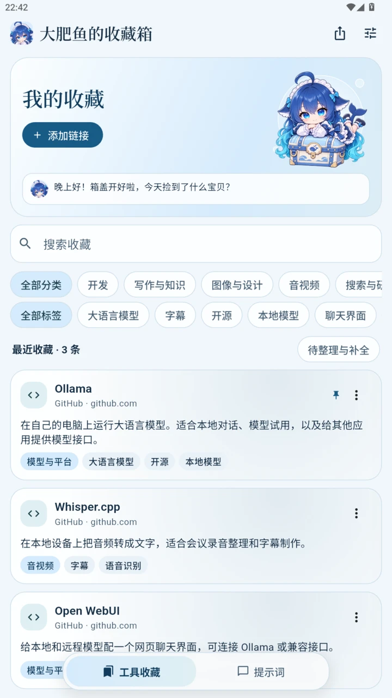
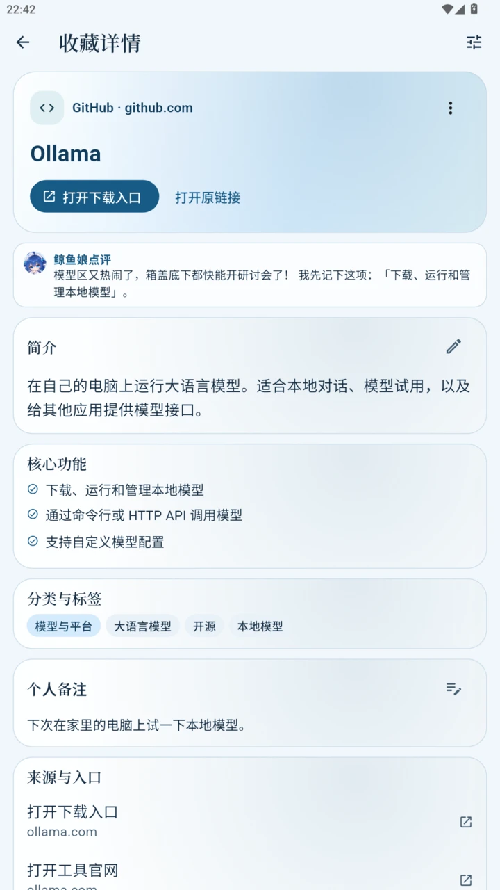
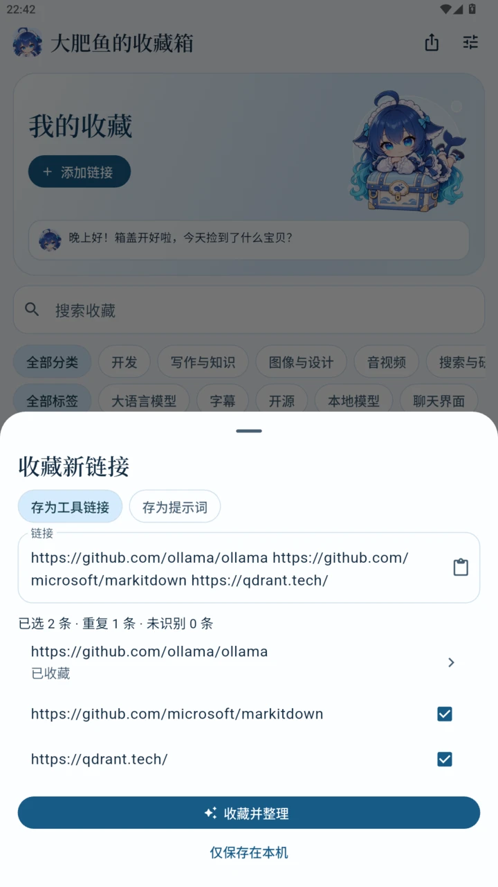
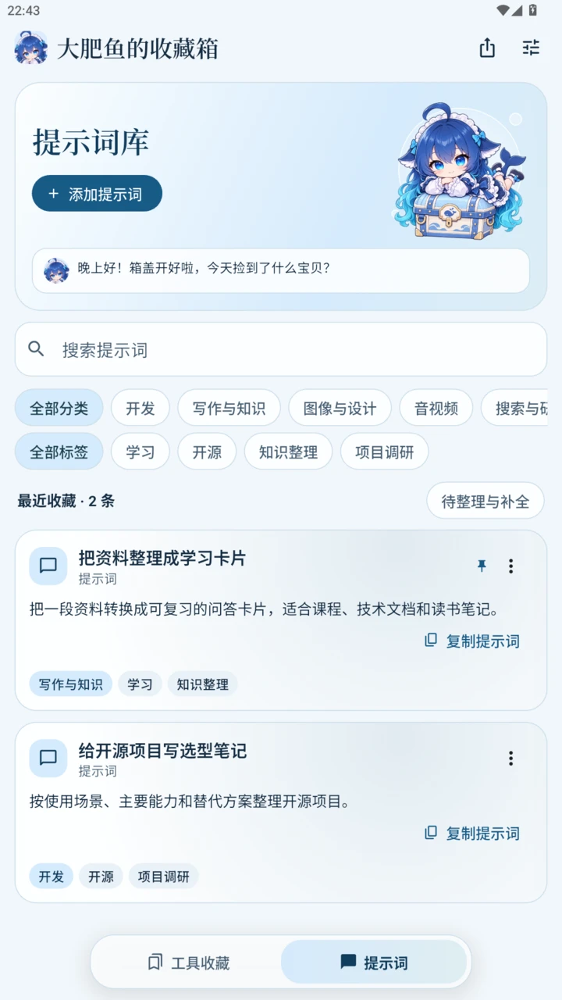
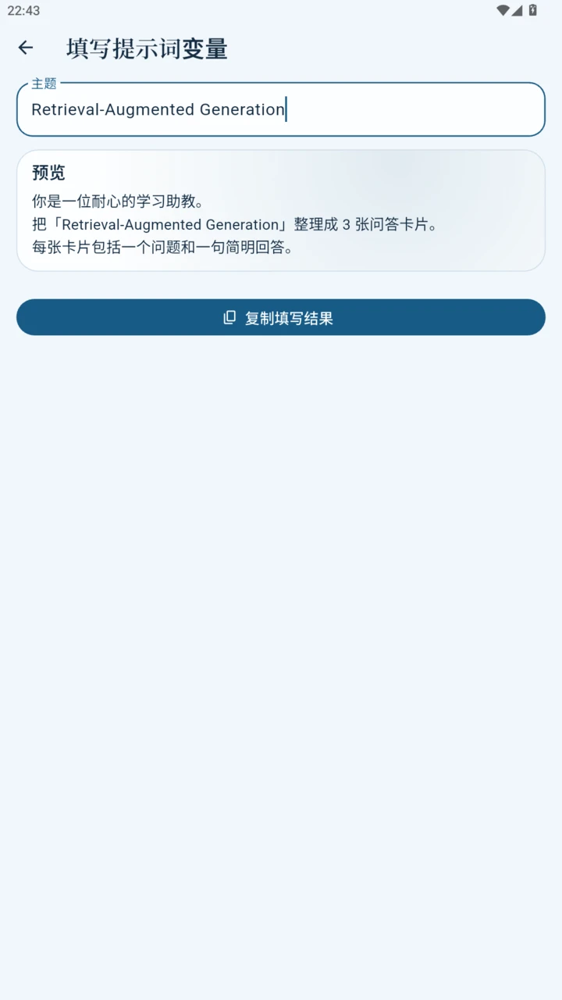
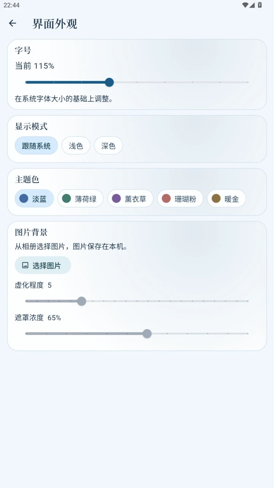

<div align="center">
  
  <h1>大肥鱼的收藏箱</h1>
  <p><strong>把散落的 AI 工具、开源项目和提示词，收进一个手机收藏箱。</strong></p>
  <p>分享一个链接，AI 帮你看懂它是做什么的、有什么用、去哪下载。</p>
  <p><a href="https://github.com/akira399/whale-collection/releases/latest"><strong>下载 Android APK</strong></a> · <a href="#上手指南">上手指南</a> · <a href="https://github.com/akira399/whale-collection/issues">反馈问题</a></p>
  <p>Android 7.0+ · Flutter · 简体中文 · 本地收藏</p>
</div>

## 在手机上看一眼

| 收藏首页 | 工具详情与下载 | 批量收藏预览 |
| :---: | :---: | :---: |
| <a href="docs/screenshots/collection.webp"></a> | <a href="docs/screenshots/tool-detail.webp"></a> | <a href="docs/screenshots/batch-import.webp"></a> |

| 提示词库 | 填写变量与预览 | 外观设置 |
| :---: | :---: | :---: |
| <a href="docs/screenshots/prompts.webp"></a> | <a href="docs/screenshots/prompt-variables.webp"></a> | <a href="docs/screenshots/appearance.webp"></a> |

以上为 Android 界面实拍，收藏内容为演示数据。点击图片可查看大图。

## 收藏之后，还能用得上

- **刷到好工具，顺手收下。** 从浏览器或其他 Android 应用分享链接，也可以一次粘贴最多 30 条。预览里能筛掉重复项、勾选想保存的链接，确认后先入库，再逐条整理。断网时照样能收藏，之后可在「待整理与补全」继续。
- **找项目时，先看用途，再去安装。** GitHub 仓库、工具官网、文章、B 站和 YouTube 链接可以整理成中文简介、核心功能、分类和标签。有可验证的下载页或官网时，详情顶部提供直达入口。来源与项目入口一起保留。
- **常用提示词，填个变量就能复用。** 把模板里的主题、受众或任务写成 `{{变量名}}`，用时填写、预览、复制，原文始终可单独复制。比如收藏一条学习卡片模板，下次只改主题就能直接用。
- **分类能改，自己的想法单独记。** 工具和提示词都支持手动编辑、自由标签、置顶和个人备注。搜索可以叠加分类与标签，也能搜到备注里的关键词。
- **换机有备份，分享有清单。** JSON 备份包含收藏、提示词、标签、置顶和备注，恢复前可预览新增与重复数。选中几条收藏即可导出 Markdown，备注与提示词原文由你选择是否附上。
- **收藏箱也能有自己的样子。** 海盐蓝主题、磨砂底栏和随倾斜变化的卡片光晕。鲸鱼娘会打招呼、点评新收藏。可调整字号、主题色和背景图片，支持系统减少动画设置。

## 上手指南

1. 到 [GitHub Releases](https://github.com/akira399/whale-collection/releases/latest) 下载 APK。大多数手机选择 `arm64-v8a`，旧款 32 位手机选择 `armeabi-v7a`，MuMu 等 x86 模拟器选择 `x86_64`。
2. 打开「添加链接」，也可以从其他应用选择「分享 → 大肥鱼的收藏箱」。点「仅保存在本机」即可直接使用收藏、搜索、筛选和手动编辑。
3. 要启用自动整理，进入「设置 → AI 服务」，选 DeepSeek 并填自己的 Key。应用预填地址并可刷新服务返回的模型列表。也可以配置支持 `/chat/completions` 的 HTTPS 模型服务。
4. 要复用提示词，切换底部「提示词」标签页，粘贴原文。保存后就能一键复制，含变量的模板在详情中可填写再复制。

从之前的测试版迁移时，请先在「设置 → 备份与恢复」导出 JSON。公开版使用独立签名，需卸载测试版后安装，再导入备份并重新填写模型 Key。

### 应用内更新

从 1.0.1 起，应用启动后会自动检查正式版本，发现新版时在首页显示提示。也可以在「设置 → 应用更新」手动检查，查看更新内容，并通过国内加速线路下载适合设备的 APK。下载后应用会校验包名、版本和签名，再由 Android 确认覆盖安装，原有收藏会保留。首次安装更新时，系统可能要求允许本应用安装其他应用。

已安装 1.0.0 的用户可从 [GitHub Releases](https://github.com/akira399/whale-collection/releases/latest) 下载最新 APK 覆盖安装一次。

## 数据与联网

- 收藏数据保存在设备的 SQLite 数据库，API Key 保存在 Android 安全存储。导出的 JSON 备份只包含收藏数据，卸载前记得备份。
- 联网整理会访问待整理链接，并向你配置的模型发送相关内容片段或提示词。资料不足时，使用 DeepSeek 官方搜索、已配置的 Tavily，或默认的 Mwmbl 补查公开资料。模型和搜索费用取决于服务商。
- 动态网页、登录或付费内容、视频平台限流都可能影响提取结果。可以保留原链接、稍后重试或手动补全。

## 从源码运行

使用 Flutter 3.47.9、Dart 3.13.7、JDK 17 和 Android SDK 36。

```sh
flutter pub get
flutter run
flutter analyze
flutter test
flutter build apk --release --split-per-abi
```

构建产物在 `build/app/outputs/flutter-apk/`。自行分发时可通过 `android/key.properties` 配置签名文件、别名和密码。公开版的签名私钥由维护者保存。 [Flutter Android 签名文档](https://docs.flutter.dev/deployment/android#sign-the-app)

正式发布使用 `vX.Y.Z` 标签和 `Whale-Collection-X.Y.Z-android-<ABI>.apk` 附件名。每次发布递增 Android 构建号，三个架构的 APK 沿用同一个发布签名。应用从最新正式 Release 读取版本和匹配的安装包。

欢迎在 [Issues](https://github.com/akira399/whale-collection/issues) 反馈解析失败的公开链接，或者分享你拿收藏箱整理了什么。喜欢这个项目，也欢迎点一颗 Star。

## 许可与致谢

项目代码采用 [MIT 许可证](LICENSE)。字体依照 [SIL Open Font License](assets/fonts/OFL-NotoSerifSC.txt) 分发。鲸鱼娘形象灵感来自中文社区同人创作，角色图、图标、品牌素材及含有这些素材的截图独立于代码许可。 [梗鲸同人档案](https://aigengtu.com/)
